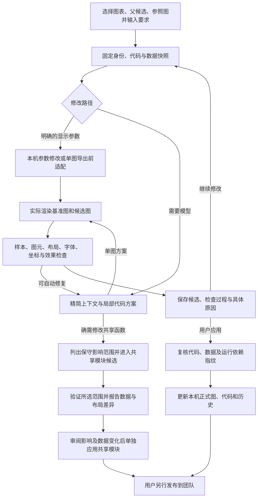

# 对话改图 Harness 与本轮优化说明

更新日期：2026-10-20。适用 v0.1.2；源码发布到 `lc` 分支。

## Harness 的职责

Harness 是负责调度、执行、核对和提交的程序层。模型负责理解需求和提出代码方案；是否能写入哪些文件、候选是否可应用、版本是否过期，由程序检查并管理。图表科学含义仍需要人审阅。

每张图、每轮 Chat 最多使用三次模型调用额度，格式重试、补上下文与候选自动修复共用。参数路径可能零调用，但仍真实出图。批量按图处理，不是整个批次共三次。

## 主要模块

| 模块 | 职责 |
| --- | --- |
| `static/app.js` | 目标选择、会话、候选、检查结果、调用用量及共享模块衔接 |
| `server.py` | 本地 HTTP 接口、项目访问与异步任务入口 |
| `chat_harness.py` | 固定版本、组织上下文、分配尝试额度、生成/修复/继续/应用候选 |
| `chat_parameters.py` | 识别明确的常用参数需求；优先替换已有参数，否则尝试图表入口内的适配 |
| `chart_overrides.py` | 在当前 Figure 导出前修改显示对象，不改共享函数源码或全局默认值 |
| `chat_agent.py` | 模型请求、上下文压缩、局部替换展开、格式和意图核对、服务端用量记录 |
| `chat_runner.py` | 快照执行、真实出图、数据图元/布局/字体/像素变化报告 |
| `chart_transform.py` | 对明确分布图转换核对完整样本、组别、标注及受支持的散点叠加 |
| `chat_diagnostics.py` | 将具体失败、无法核对、布局和服务错误解释成用户可操作的信息 |
| `chat_module_route.py` | 将明确的共享模块请求限制在可编辑模块目录，提供单独审阅入口 |
| `module_workflow.py` | 临时替换共享模块出图，逐图比较、候选保存、单独确认和应用 |

## 单图候选如何产生

1. 固定图表身份、正式版本、只读数据/依赖和参照版本；选择活跃候选时以其入口代码为修改起点。正式代码、数据或运行依赖变化会触发冲突核对。
2. 简单字号、刻度字号、图例字号/位置、折线颜色或坐标范围请求先尝试本机参数路径。语句或对象不明确时回退模型，不猜测多条系列或多个坐标轴。
3. 模型看到受大小限制的代码、数据列/样本、近期对话和检查反馈。数据可能被抽样用于模型理解；程序验证仍读取快照内完整数据，不能用抽样数据冒充完整样本。图像输入按模型配置开启。
4. 模型优先给出局部替换。适配层补充请求拥有的固定元数据；图表范围、父版本哈希、原话引用、数据列及意图仍须核对。普通 Chat 不允许修改共享模块。
5. 在临时工作副本中渲染基准和候选。默认 local 模式以本机用户权限运行，没有 OS 沙箱；可选 Seatbelt/Docker 才提供操作系统隔离。基础导入限制和数据检查不构成安全沙箱或科学等价证明。
6. 检查图型转换、原有数据/映射、可见性/范围授权、新增对象授权、字体、布局、坐标要求及实际图像变化。首个阻断条件决定候选状态；逐项报告保留其他已观察结果，不把“未发现阻断项”说成全面验证。
7. 需要时在剩余额度内自动修复。成功候选、仅布局冲突的可继续候选可作为下一轮起点；失败不覆盖先前可用起点。当前不允许无法核对的数据通过后续普通样式修改绕过检查。
8. 应用时再次复核输入及依赖，明确应用指定候选后才更新正式文件和历史；团队发布是另一步操作。

## 本轮优化与效果

| 优化 | 能达到的效果 | 边界 |
| --- | --- | --- |
| 失败分类、逐项检查与修复记录 | 区分数据不一致、当前无法核对、布局/字体、模型服务或格式问题；能查具体原因 | 历史记录未保存的中间过程无法补回 |
| 可修正的模型格式错误重试 | 局部替换定位失败、数据列名/用途格式不完整时，在原三次额度内要求修正 | 文件范围越界、错误版本和真实数据不一致不会因此放行 |
| 扩大的参数路径 | 支持入口函数、动态已有参数，以及共享函数返回 Figure 后的单图显示适配；可省模型调用 | 需要明确的 `Figure.savefig` 导出边界；共享函数内部直接导出等情形回退模型/共享候选 |
| 去除参数路径重复字体预渲染 | 命中时省去单独的字体读取出图，保留基准/候选真实比较 | 绘图仍有本机耗时；没有真实模型端到端百分比提速承诺 |
| 导出前局部适配合并 | 多轮修改合并已有单图设置，保留其他已确认参数，不不断追加重复块 | 多坐标轴或多系列歧义由运行检查拦截或回退 |
| 横向分布图转换 | 保留组别对应，在方向切换时核对轴标题/单位的合理交换 | 组别重排或新的科学含义仍需明确核对 |
| 分布图叠加完整样本散点 | 允许可归组的抖动散点，逐组完整样本必须与分布输入相同 | 仅叠加部分样本、额外数据层或无法归组不自动放行 |
| 多子图逐图核对 | 有原始分布样本锚点时，发现漏样本、改值和子图样本对调 | 从均值/误差图直接转多子图分布、缺少原始逐图映射时仍报告无法核对 |
| 缺失值/不支持来源单独说明 | 不把没有对应来源或未知缺失值处理直接说成数据已改 | 不静默删除、填补样本；需要明确的数据处理规则 |
| 共享模块衔接 | 带原需求和选中图进入模块候选，展示可能影响的全部图，默认验证全部 | 影响范围为保守范围；进入窗口本身不修改文件，也不等于其他图不受影响 |
| 共享候选统一渲染报告 | 对验证图提供图元、数据、可见性、坐标和布局比较；数据/映射变化单独确认 | 共享模块仍无完整科学语义证明，人工确认不显示成自动样本核对通过 |
| 共享输入版本检查 | 将全部图表入口、元数据、共用代码和数据绑定到候选；其他入口变更也会要求重验 | 同进程提交锁和指纹复核不替代跨进程事务 |
| 调用、耗时及 token 展示 | 区分本机零调用、模型重试和服务端报告的实际用量 | 服务端未报告的 token 显示未知，不估算为零 |

用量记录目前针对 Chat Agent 请求。标准化和独立共享模块建议仍使用各自的模型路径；标准化界面明确显示用量暂未报告，不会将其默认的零计数误报为没有调用模型。

此前已补充的横向柱宽、散点颜色数值和热图网格坐标检查也继续保留。数据变化不能只看 CSV 是否改变：代码可能换分组、丢样本、改变汇总方式或绘制错误的值。

## 如何避免修改一张图却改变其他图

优先修改入口参数或当前 Figure 的显示对象。这样正式写入仅发生在选中入口，共享函数和其他入口不变。共享函数内部逻辑必须改变时，由独立共享候选处理；所有调用图可能受影响，不能用“已列出影响范围”代替逐图验证。

共享候选的“全部验证”覆盖当前项目图表；代表图模式只检查所选图，不能证明其余图都正确。出现数据/图元/可见性/范围差异时，必须审阅报告并单独确认这些变化才可应用。普通 Chat 的数据核对规则不会因此被豁免。

## 当前仍有的边界

- 不是任意图型的科学等价验证器；自定义 artist、统计含义、复杂变换、变量含义和原始实验处理仍需人工审阅。
- 多子图必须有可核对的逐图样本对应；没有证据时不能通过匹配任意一个 CSV 列来批准转换。
- 来源含缺失/非有限值时，不自动决定删除、填补或统计处理规则。
- 本地锁与版本指纹不等于分布式事务；当前为本机工作台与异步 Git 协作。
- 默认本机运行没有 OS 沙箱；不要执行不可信代码或 Bundle。
- 测试模型响应与实际服务商输出质量不同；自动回归能证明程序行为，不能保证真实模型每次正确理解需求。

## v0.1.2：相对参数与数据来源证据

“字大一点”“坐标轴粗一点”等相对请求读取当前 Figure 对象的实际字号或可见轴线宽度，以 1.2 倍／除以 1.2 调整，不要求用户先给数值。重复请求合并累计到当前入口的参数适配块；隐藏轴线不被打开，数据曲线宽度不受轴线请求影响。支持明确的单坐标轴场景；仍走真实渲染、数据与布局检查。

分布图缺少候选绘图调用记录时，先检查已知 CSV/TSV 的哈希、分组与数值列，区分 available、summary_only、insufficient_samples、unresolved、changed。available 只证明已有源数据可用，不证明候选实际使用正确；需要继续修复并取得样本证据。仅有汇总值或明确样本不足时停止自动修复，告知具体缺口；unresolved 不表述为“数据不存在”。
