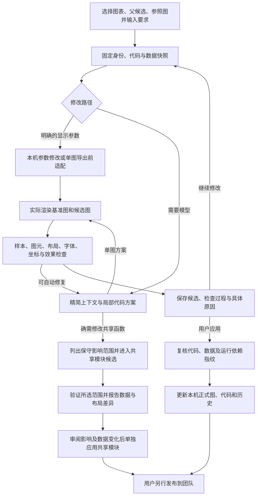

# 对话改图 Harness 与本轮优化说明

2026-10-21 操作策略更新：所有候选质量与版本检查只提供信息，不再限制“应用此版”或“基于此版修改”。包括样本/映射差异、图型与配对核查、标注/图例、布局、字体、轴范围、意图未满足、无可见变化、旧候选和运行规则版本变化。只要候选代码存在，就可选择继续或点击应用；应用会保存当时正式版本的历史，不弹出额外审阅确认。候选没有图片时先执行一次代码尝试出图；代码实际运行失败、文件不存在或写入失败仍会返回真实执行错误，并保持正式文件不被部分覆盖。已应用/已放弃的代码版本也可以再次选择。会话正在生成时仍等待生成完成，避免并发写入。此前章节中的强制验收描述现改为诊断说明。

更新日期：2026-10-21。适用 v0.1.3，包含参考图视觉读取、代码生成、候选视觉对照及检查仅提示的操作策略。

## Harness 的职责

上传参考图片时，当前流程为：视觉 Agent 读取图片并提取带来源与依据的关键特征 → 绘图 Agent 将特征转为代码 → 实际渲染 → 视觉 Agent 独立读取最终候选与参考图，逐项报告一致、有差异、无法确认或不适用。两个 Agent 角色使用 API 配置中的同一个支持图片输入的模型，视觉核对不读取候选代码来冒充图像证据。

关键特征与对照结果保存在候选及历史中；相同参考图 ID 和内容版本的特征在会话内复用。读图、代码生成、格式/执行修复、视觉核对共用每图每轮最多三次模型调用。若修复用完预算或视觉核对连接失败，结果明确显示尚未完成，不声称一致，也不隐藏已有候选。

外观对照是审阅信息，一致与否都可继续修改或应用。若还有字体、布局或展示要求差异，但完整样本与数据映射检查允许继续，会显示“应用此版”，记录用户接受的展示差异；正式版本/依赖冲突、代码运行失败及数据核对失败仍不能跳过。半小提琴在参考改图中显示不清属于外观差异，原样本和配对核对继续独立执行。未上传参考图的原有验收规则不变。

Harness 是负责调度、执行、核对和提交的程序层。模型负责理解需求和提出代码方案；是否能写入哪些文件、候选是否可应用、版本是否过期，由程序检查并管理。图表科学含义仍需要人审阅。

每张图、每轮 Chat 最多使用三次模型调用额度，格式重试、补上下文与候选自动修复共用。参数路径可能零调用，但仍真实出图。批量按图处理，不是整个批次共三次。

## 主要模块

| 模块 | 职责 |
| --- | --- |
| `static/app.js` | 目标选择、会话、候选、检查结果、调用用量及共享模块衔接 |
| `server.py` | 本地 HTTP 接口、项目访问与异步任务入口 |
| `chat_harness.py` | 固定版本、组织上下文、分配尝试额度、生成/修复/继续/应用候选 |
| `chat_parameters.py` | 识别明确的常用参数需求；优先替换已有参数，否则尝试图表入口内的适配 |
| `chart_overrides.py` | 在当前 Figure 导出前修改显示对象，不改共享函数源码或全局默认值 |
| `chat_agent.py` | 模型请求、上下文压缩、局部替换展开、格式和意图核对、服务端用量记录 |
| `chat_runner.py` | 快照执行、真实出图、数据图元/布局/字体/像素变化报告 |
| `chart_transform.py` | 对明确分布图转换核对完整样本、组别、标注及受支持的散点叠加 |
| `chat_diagnostics.py` | 将具体失败、无法核对、布局和服务错误解释成用户可操作的信息 |
| `chat_module_route.py` | 将明确的共享模块请求限制在可编辑模块目录，提供单独审阅入口 |
| `module_workflow.py` | 临时替换共享模块出图，逐图比较、候选保存、单独确认和应用 |

## 单图候选如何产生

1. 固定图表身份、正式版本、只读数据/依赖和参照版本；选择活跃候选时以其入口代码为修改起点。正式代码、数据或运行依赖变化会触发冲突核对。
2. 简单字号、刻度字号、图例字号/位置、折线颜色或坐标范围请求先尝试本机参数路径。语句或对象不明确时回退模型，不猜测多条系列或多个坐标轴。
3. 模型看到受大小限制的代码、数据列/样本、近期对话和检查反馈。数据可能被抽样用于模型理解；程序验证仍读取快照内完整数据，不能用抽样数据冒充完整样本。图像输入按模型配置开启。
4. 模型优先给出局部替换。适配层补充请求拥有的固定元数据；图表范围、父版本哈希、原话引用、数据列及意图仍须核对。普通 Chat 不允许修改共享模块。
5. 在临时工作副本中渲染基准和候选。默认 local 模式以本机用户权限运行，没有 OS 沙箱；可选 Seatbelt/Docker 才提供操作系统隔离。基础导入限制和数据检查不构成安全沙箱或科学等价证明。
6. 检查图型转换、原有数据/映射、可见性/范围授权、新增对象授权、字体、布局、坐标要求及实际图像变化。首个阻断条件决定候选状态；逐项报告保留其他已观察结果，不把“未发现阻断项”说成全面验证。
7. 需要时在剩余额度内自动修复。成功候选、仅布局冲突的可继续候选可作为下一轮起点；失败不覆盖先前可用起点。当前不允许无法核对的数据通过后续普通样式修改绕过检查。
8. 应用时再次复核输入及依赖，明确应用指定候选后才更新正式文件和历史；团队发布是另一步操作。

## 本轮优化与效果

| 优化 | 能达到的效果 | 边界 |
| --- | --- | --- |
| 失败分类、逐项检查与修复记录 | 区分数据不一致、当前无法核对、布局/字体、模型服务或格式问题；能查具体原因 | 历史记录未保存的中间过程无法补回 |
| 可修正的模型格式错误重试 | 局部替换定位失败、数据列名/用途格式不完整时，在原三次额度内要求修正 | 文件范围越界、错误版本和真实数据不一致不会因此放行 |
| 扩大的参数路径 | 支持入口函数、动态已有参数，以及共享函数返回 Figure 后的单图显示适配；可省模型调用 | 需要明确的 `Figure.savefig` 导出边界；共享函数内部直接导出等情形回退模型/共享候选 |
| 去除参数路径重复字体预渲染 | 命中时省去单独的字体读取出图，保留基准/候选真实比较 | 绘图仍有本机耗时；没有真实模型端到端百分比提速承诺 |
| 导出前局部适配合并 | 多轮修改合并已有单图设置，保留其他已确认参数，不不断追加重复块 | 多坐标轴或多系列歧义由运行检查拦截或回退 |
| 横向分布图转换 | 保留组别对应，在方向切换时核对轴标题/单位的合理交换 | 组别重排或新的科学含义仍需明确核对 |
| 分布图叠加完整样本散点 | 允许可归组的抖动散点，逐组完整样本必须与分布输入相同 | 仅叠加部分样本、额外数据层或无法归组不自动放行 |
| 多子图逐图核对 | 有原始分布样本锚点时，发现漏样本、改值和子图样本对调 | 从均值/误差图直接转多子图分布、缺少原始逐图映射时仍报告无法核对 |
| 缺失值/不支持来源单独说明 | 不把没有对应来源或未知缺失值处理直接说成数据已改 | 不静默删除、填补样本；需要明确的数据处理规则 |
| 共享模块衔接 | 带原需求和选中图进入模块候选，展示可能影响的全部图，默认验证全部 | 影响范围为保守范围；进入窗口本身不修改文件，也不等于其他图不受影响 |
| 共享候选统一渲染报告 | 对验证图提供图元、数据、可见性、坐标和布局比较；数据/映射变化单独确认 | 共享模块仍无完整科学语义证明，人工确认不显示成自动样本核对通过 |
| 共享输入版本检查 | 将全部图表入口、元数据、共用代码和数据绑定到候选；其他入口变更也会要求重验 | 同进程提交锁和指纹复核不替代跨进程事务 |
| 调用、耗时及 token 展示 | 区分本机零调用、模型重试和服务端报告的实际用量 | 服务端未报告的 token 显示未知，不估算为零 |

用量记录目前针对 Chat Agent 请求。标准化和独立共享模块建议仍使用各自的模型路径；标准化界面明确显示用量暂未报告，不会将其默认的零计数误报为没有调用模型。

此前已补充的横向柱宽、散点颜色数值和热图网格坐标检查也继续保留。数据变化不能只看 CSV 是否改变：代码可能换分组、丢样本、改变汇总方式或绘制错误的值。

## 如何避免修改一张图却改变其他图

优先修改入口参数或当前 Figure 的显示对象。这样正式写入仅发生在选中入口，共享函数和其他入口不变。共享函数内部逻辑必须改变时，由独立共享候选处理；所有调用图可能受影响，不能用“已列出影响范围”代替逐图验证。

共享候选的“全部验证”覆盖当前项目图表；代表图模式只检查所选图，不能证明其余图都正确。出现数据/图元/可见性/范围差异时，必须审阅报告并单独确认这些变化才可应用。普通 Chat 的数据核对规则不会因此被豁免。

## 当前仍有的边界

- 不是任意图型的科学等价验证器；自定义 artist、统计含义、复杂变换、变量含义和原始实验处理仍需人工审阅。
- 多子图必须有可核对的逐图样本对应；没有证据时不能通过匹配任意一个 CSV 列来批准转换。
- 来源含缺失/非有限值时，不自动决定删除、填补或统计处理规则。
- 本地锁与版本指纹不等于分布式事务；当前为本机工作台与异步 Git 协作。
- 默认本机运行没有 OS 沙箱；不要执行不可信代码或 Bundle。
- 测试模型响应与实际服务商输出质量不同；自动回归能证明程序行为，不能保证真实模型每次正确理解需求。

## v0.1.2：相对参数与数据来源证据

“字大一点”“坐标轴粗一点”等相对请求读取当前 Figure 对象的实际字号或可见轴线宽度，以 1.2 倍／除以 1.2 调整，不要求用户先给数值。重复请求合并累计到当前入口的参数适配块；隐藏轴线不被打开，数据曲线宽度不受轴线请求影响。支持明确的单坐标轴场景；仍走真实渲染、数据与布局检查。

分布图缺少候选绘图调用记录时，先检查已知 CSV/TSV 的哈希、分组与数值列，区分 available、summary_only、insufficient_samples、unresolved、changed。available 只证明已有源数据可用，不证明候选实际使用正确；需要继续修复并取得样本证据。仅有汇总值或明确样本不足时停止自动修复，告知具体缺口；unresolved 不表述为“数据不存在”。

## 换图型时复用标准化 Skill

明确的换图型请求会携带 `chart_type_style`：来源为 `skills/chart-normalization/assets/style-profile.v1.json`，记录版本、完整内容哈希、匹配模板、通用规则和明确的用户覆盖项。不会维护第二套宽度、字号或分位线数值。标准化本身仍保持原图型；用户明确要求转换时，只授权该图型转换，再复用标准化的展示规则。

箱线/小提琴的普通 Matplotlib 调用在候选源码中转接到平台固定函数；可识别的 CHART_OUTPUT 导出调用复用原 `finish_normalized_figure`。两组竖向单图适用对应模板，其他组数、水平或复杂子图只应用适用规则并报告 missing_template。小提琴三分位线和连接线直接复用 `add_normalized_violin_quartiles`，按完整原始样本核对。样式规则不能批准错误样本或布局冲突，规则更新后旧候选应用前要求重验。其他图型把同一 Skill 的适用规则交给模型实现，仍接受原有数据/布局检查，不宣称通用科学等价核对。

既有统计选择（须线、离群点、分箱、带宽、误差定义和拟合）不会因为统一样式而被默认替换；不得为补齐外观生成缺失样本、误差或p值。

## 明确显示参数的导出优先级

标准化是默认起点，不能覆盖后续明确编辑。`finish_converted_figure(..., parameters={...})` 先规范化，再应用当前图的参数覆盖，最后保存。已知导出函数的字号、轴线宽与范围等参数请求走这一出口；普通 `Figure.savefig` 仍采用导出前适配块。相对值在源码参数字典内累计，避免重复叠加代码块。

“我现在希望把这2个图的xy轴粗细调整一下，都细一些，粗细是现在的一半”等明确减半要求直接解析为轴线宽乘0.5，不修改刻度线、数据线和共享规则。渲染报告记录实际 spine_linewidths，检查相对目标是否在最终图片中实现；其他像素变化不能代替轴线目标核对。

## 最终导出需求验收（本地源码新增）

明确的用户修改优先于既有样式和图型默认规范；数据样本、单位及科学含义仍单独核查。

支持解析为确定目标的字号（轴标题、刻度、图例、文字相对大小）、轴线相对粗细、单条折线颜色、图例角落位置和 X/Y 范围，会从原话建立 `edit_contract`，对照最终 PNG 保存时捕获的 Matplotlib 属性验收。目标不来自模型的完成声明。轴范围继续核对轴线边界和连续性，明确要求端点刻度时同时核对刻度。图例位置核对 Matplotlib loc 属性，不等于对任意外置图例布局作保证。

一条指令中最多六个互不冲突、可完整解析的参数要求可依次生成同一个本图候选，不额外请求模型。包含未知操作、重复冲突目标的指令整体交回模型，不会只执行已理解的片段。参数仍经过最终渲染、数据及布局检查。

验收结果逐项显示原话、目标、导出值及原因：已识别目标不符为 `intent_unmet`；缺少唯一目标或测量为 `intent_unverified`，均不允许应用，可基于候选继续修改，并将实测结果反馈给模型修复。自动修复与其他模型调用共用每张图每轮最多三次的额度。复杂要求尚不能完整解析时标为人工审阅，不宣称自动验证通过，也不仅因为自动测量尚未覆盖就禁止用户审阅候选。

明确说“其他不变”时，额外核对未请求修改的已测量标签、轴标题字号、线色、轴线宽、图例属性和坐标范围；不逐像素锁定会随文字大小自然移动的布局。数据和布局沿用各自检查，不承诺覆盖所有自定义图元。

候选摘要按最终状态生成；模型原摘要保存为 `proposal_summary` 供追溯。项目历史保留需求验收、检查明细及诊断，应用前再次拦截未通过的已测量要求。此机制不能证明任意复杂自然语言意图均被实现，超出覆盖范围的要求仍需人工核对。

数值线性坐标轴修改范围时，在标准化之后重建包含两端的整组等距主刻度，遵守样式规范的刻度数量上限，避免将端点插入旧刻度造成短间隔。例如 0.1～0.8 在五个主刻度时为 0.1、0.275、0.45、0.625、0.8，间隔均为 0.175。最终导出验收检查相邻数值差，界面显示刻度值与间隔；分类、日期和对数坐标不会按此规则强制重写。

Chat 范围默认策略已覆盖普通 `Figure.savefig` 导出、已知图型标准化导出，以及模型候选的可识别导出路径；普通范围修改不再仅替换 `set_xlim/set_ylim` 的字面值。Harness 将从原话识别出的范围接入本图导出前的等距刻度适配，并把适配保存进候选入口，应用后再次出图仍保持一致。无法安全定位的自定义导出或不明确的子图目标会继续核对/报告限制，不静默宣称已生效。
# 配对连线与参考半小提琴的数据路径

参考改图中，若完整样本、实际观测值及被试连线端点核对通过，只有组别表达位置或统计标注形式待核查，候选记为 `presentation_review`，可直接作为下一轮修改起点，不必全部重画。它不是全面验收通过，也不自动应用正式图。未核对的数据元素、实际观测值变化和错连仍不能使用这一继续条件。

分类轴上的横向排版偏移不再按数据修改阻断。最终核对保留逐条纵轴观测值与顺序、完整样本和配对签名，并检查每条连线的端点是否仍对齐同一被试的两个散点。点和线同步横移可以通过；改变观测值、错连被试或隐藏观测点仍会报告具体原因。旧版候选需要重新渲染核查后才使用此规则。

Chat 上下文对可识别的逐条长表提供 `paired_plot_data`：固定当前指标、数据文件与版本、条件列、受试者列、数值列、各组完整样本数和可配对数。条件名相同不允许跨指标混用；受试者 ID 重合也不自动证明实验上存在配对关系。

`paired_plot` 为改图和标准化提供同一套函数：筛选指标 → 分条件 → 检查条件内 ID 唯一与数值有限 → 按 ID 对齐 → 绘制。未配对记录保留在分布与散点中，只省略其连接线并报告数量；重复记录不自动平均或去重。半小提琴由标准 Matplotlib 密度裁去一半的顶点绘制，无需 Bbox 裁剪调用。

候选最终导出时记录完整样本签名、配对签名和实际图元几何，复核源数据版本、样本、ID 对应、图元可见性以及半小提琴的像素跨度。自定义绘制若未接入可核对接口，不会据此自动放行。混入其他指标造成样本数膨胀时，报告实际数与当前指标预期数，并在三次调用总预算内尝试修复。

参考图中的非必要连接线缺少配对依据时，可以省略并说明；只有结构化明确省略、使用受核查绘制函数且最终确无连线，才能把这项局部疑问作为已处理选择。数据缺口和用户明确要求但无法实现的连接仍阻断。修复不会自动应用正式图。
