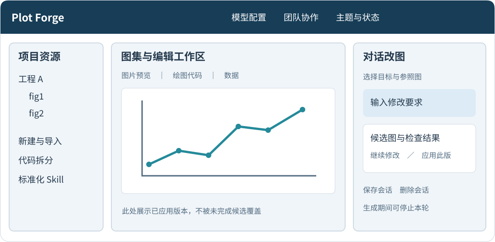
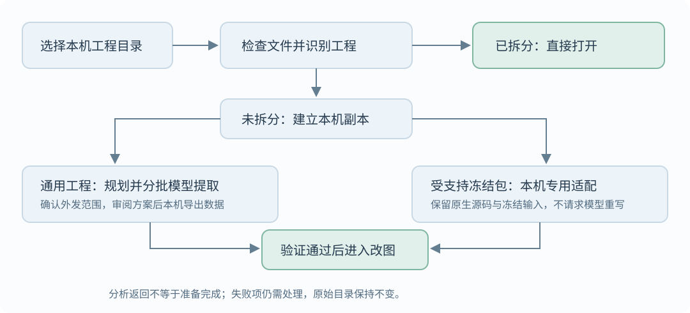
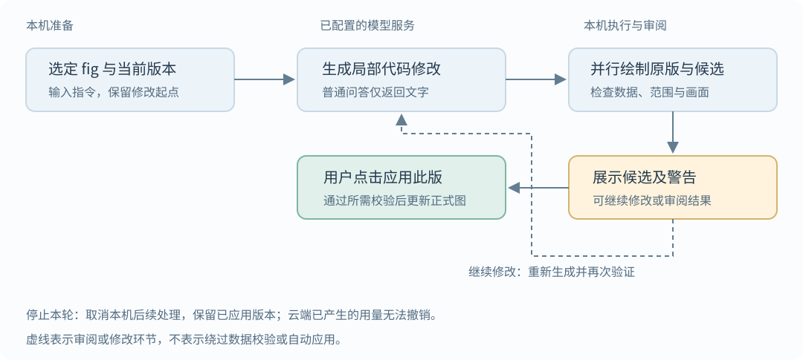

# Plot Forge 功能说明与使用指南

更新日期：2026 年 10 月 21 日

Plot Forge 是面向 Python 科研绘图的本地工作台。它把工程准备、绘图代码、数据预览、自然语言改图、候选审阅和版本管理集中在一个界面中。核心工作方式是：先准备可独立绘制的工程，再通过对话生成候选图，最后由用户确认应用。

本说明对应当前工程版本。应用在本机运行，不代表所选模型也在本机运行；云端模型会接收本次请求所需的资料。

## 1 快速开始

当前开发环境入口为 <http://127.0.0.1:8767/>，其他部署以启动器显示的地址为准。

1. 打开顶部“API 配置”，选择 API Key 或 ChatGPT 订阅连接，保存配置并测试。
2. 打开“标准化已有目录”。已有准备完成的工程，选择“打开已拆分工程”；新目录选择“新建 / 继续拆分”。
3. 新工程先检查文件清单，建立本机副本，再按识别结果完成拆分和验证。未完成准备的副本不会作为已拆分工程直接打开。
4. 在中央图集中选择一张图，在右侧输入修改要求。
5. 查看候选图片、修改说明和警告；满意后点击“应用此版”，正式图才会更新。

## 2 工作台布局

图 1 工作台布局示意，非实际界面截图；示例折线不代表科研数据。

- 左侧项目资源：浏览工程和绘图入口，新建工程、上传代码与数据、管理标准化 Skill。
- 中央工作区：项目图集、绘图代码、CSV 数据预览，以及重新渲染和导出入口。
- 右侧对话区：选定改图目标、配置只读参照图、输入要求、查看候选、管理会话。
- 顶部工具栏：模型配置、团队协作、明暗主题和运行状态。

图集按需加载图片，并复用预览缓存。切换工程会取消旧的前端图片请求，避免阻塞新图；读取失败后可重试。取消浏览器图片请求不等于立即终止后台已经开始的渲染。

## 3 工程导入与代码拆分

图 2 已拆分工程直接打开，新工程依据识别结果选择准备路径。

### 已拆分工程

准备完成的本机工程可直接打开，不需要每次重新分析或发送全部源码。兼容的标准工程备份解压后，也可恢复为可改图工程；运行绘图代码前仍需审阅和授权。

### 新建工程与整文件夹拆分

可以选择本机 Python 工程目录，也可以从界面上传支持的代码和数据。目录检查本身不运行原始分析；应用只复制支持的文件，跳过隐藏目录、符号链接和疑似凭据文件，因此本机工作副本不等于原工程的完整灾备。

大型目录支持整工程规划和分批提取：

1. 本机扫描目标源码、可识别的本地依赖及文件覆盖范围。
2. 展示批次和拟发送范围，经用户确认后逐批请求模型。
3. 显示批次分析进度、处理状态和需解决的问题。
4. 下载提取方案，审阅生成的导出与绘图程序。
5. 按方案在原分析环境中导出绘图数据，再在应用中验证、汇总。

单次分析源码上限为 180,000 字符，不会通过静默截断依赖来绕过上限。动态依赖、超限或没有独立图表的批次可能需要人工处理。模型分析返回不等于拆分成功，全部必要验证通过后才可进入改图。

### 已识别冻结绘图包的本机适配

当前对 `main_figure_plotting_package_20261016` 有专用适配，可在本机保留原始源码和冻结输入，建立 `fig1` 至 `fig7` 的独立绘图入口，不必让模型重新生成科学计算。

这属于特定包适配，不代表任意目录都能一键拆分。Linux 下该路径要求 bubblewrap 系统沙箱及专用原生绘图环境；缺少条件时不会自动降级成无沙箱执行。试绘通过也不等于与旧参考图片逐像素一致。

### 工程管理与备份

- 可修改工程显示名称，继续未完成的准备流程。
- 准备完成后可下载标准工程 ZIP，以便迁移和恢复代码、数据及支持的工程资产。
- 删除工程前需要核对范围并输入完整工程名称；删除的是应用中的工作副本，不删除原始目录或已下载的备份。
- 工程副本的删除不可撤销，和下文“会话删除移入回收目录”不同。

标准备份会排除隐藏目录，因此不包含 `.chat` 中的对话会话、未应用候选和会话回收目录，也不包含模型登录凭据。需要保存这些本机记录时，应另外安全备份工作目录中的对应内容，不要将其上传到公共仓库。

## 4 模型连接

| 连接方式 | 配置内容 | 主要边界 |
| --- | --- | --- |
| 本地或内网 API | 完整 Chat Completions 地址、模型名称、对应 Key | 资料发送给该地址；只有模型服务确实在本机时，才属于本机推理 |
| 硅基流动或自定义 API | 选择预设或填写完整兼容接口地址 | 使用该服务的账户、网络和计费规则 |
| ChatGPT 订阅 | 官方登录、读取账户可用模型、单独确认代码发送权限 | 是否可调用及额度限制取决于账户实际获准的权限 |

API Key 方式支持本地 / 内网、硅基流动和自定义地址。请求按用户明确选择的地址发送，不通过 Key 格式猜测服务商。变更 API 地址时必须重新输入目标服务的 Key，防止旧密钥误发。

ChatGPT 路径使用官方 OAuth 登录，不要求在 Plot Forge 中输入 ChatGPT 密码或浏览器 Cookie。后台检查订阅使用授权，再携带 OAuth 令牌请求 Responses 接口；仅登录成功不代表订阅额度已获准。订阅调用失败不会自动切换为付费 API Key。

密钥和登录凭据优先存入系统凭据库；不可用时仅在后台内存中保存。界面不回显密钥。连接测试只发送简短测试语句，不等于真实改图任务已经验收通过。

可设置最大输出 token，并选择是否发送当前图及参照图给支持视觉输入的模型。当前应用不提供精确的 ChatGPT 剩余额度统计。

## 5 对话改图

### 支持的交互

可以提出配色、线宽、标记、字体、坐标轴、图例、布局和图形类型等修改，也可以要求解释当前代码、讨论修改方案或进行普通问答。能否实现具体修改取决于源代码、数据和可编辑元素，不是任意图片编辑器。

示例：

- “将图 c 改为散点图，保留所有坐标数据。”
- “横纵坐标轴加粗，其余保持不变。”
- “图例稍微向左移动，字体大小不变。”
- “参考图 A 的配色，但不要修改图 A。”
- “解释当前绘图代码，不要修改文件。”

一句话同时包含问题和修改时，系统会尝试回答并处理修改。缺少原始样本时不能从均值和误差凭空生成箱线图或小提琴图；嵌入式栅格也不一定具备可独立编辑的图中元素。

### 一次修改的流程

图 3 模型只提出修改，本机绘图验证，用户决定是否应用。

输入要求 → 确认选定 fig 和修改起点 → 准备代码与必要资料 → 模型返回代码补丁 → 本机绘制原版和候选 → 数据及画面检查 → 展示候选 → 用户确认应用。

修改起点可以是当前正式版，也可以是允许继续修改的历史候选。参照图只读，提到另一张图不会自动改变界面选定的修改目标。多图选择会按各图分别处理，不代表一次请求可以任意改动整个工程。

### 预览优先与部分结果

明确的视觉要求允许采用合理默认值，不强制用户给出精确像素、间距或线宽。可独立完成的部分可以先生成候选，并显示“部分完成”、未完成项和原因。不会将部分结果描述为全部完成。

布局或字体效果存在问题时，可能显示带警告的诊断图，允许继续修复；这不代表所有检查通过。部分候选需要补充确认或明确接受所列布局冲突后才能应用。数据完整性、修改范围等保护不能通过接受布局警告解除。

### 验证与正式版本

平台检查允许修改的文件、依赖版本、只读输入、可观察的数据变化，以及部分字体、布局、坐标轴和视觉效果。折线转散点等受支持转换会进行逐点数据核对。

检查不能全面证明科学语义正确、所有重叠均被发现或模型完整理解了要求。正式应用前仍需人工核对。未应用的候选不会替换中央图集中的正式图。

### 等待与停止

对话会显示“准备图表资料”“等待模型生成代码”“渲染并检查候选图”等阶段及等待时间。等待模型与本机渲染是不同耗时来源，复杂图可能仍需较长时间。

点击“停止本轮”可发出取消信号，终止本轮绘图子进程并阻止迟到模型结果进入候选。已应用版本保留。已发送到云端的请求不保证立即停止计算，已经产生的用量无法撤销。

## 6 会话与版本管理

对话自动保存在本机，可输入名称点击“保存会话”，之后从当前目标的会话列表重新打开。会话包含对话、候选和继续修改所需的关联记录，并非 ChatGPT 网站中的聊天记录。

删除会话需要确认，会将所选会话目录移入工程下的 `.chat/deleted_sessions/`，不删除正式图表、代码或原始数据。目前没有界面一键恢复入口，恢复需由维护者处理。运行中的会话须先停止并等待结束，才能保存或删除。

图表还支持查看修改历史和恢复保留的历史代码。旧版本并非永久保留所有代码；界面提供“修改完成，清理旧历史”，使用前应确认不再需要旧候选和版本，重要结果先备份。

## 7 标准化和其他编辑入口

- 标准化 Skill：查看、上传或删除支持的绘图规范，并对选定图表执行批量标准化。
- 代码编辑：查看当前 Python 绘图代码，手动修改后验证保存。
- 数据预览：查看 CSV 等支持数据的字段和部分行，不是完整数据分析工作台。
- 共享模块编辑：对支持的共用绘图模块生成修改建议，按代表图或影响范围验证候选，审阅后应用。
- Bundle 导入：支持界面中列出的 Border / Group Plot Bundle，浏览器上传或从本机目录导入；导入不等于向团队发布。
- 图片导出：支持路径提供相应导出入口；当前提取契约和原生适配工程主要输出 PNG，SVG / PDF 需相应绘图路径支持，不能保证所有工程可导出矢量格式。

## 8 团队协作

配置好的团队版本可以通过 GitHub 共享代码、数据、正式图片和正式历史。成员填写协作者身份，使用本机已有的 Git 凭据；仓库写权限仍由 GitHub 控制。

支持获取远端更新和手动发布本机正式修改，发生冲突时需处理，不会强制覆盖。候选必须先应用才属于正式修改；新导入的本机私有工程默认不参与团队发布。模型密钥、登录凭据和本机候选不作为正式团队内容发布。

团队工程的本机删除可能在后续发布或拉取时影响同步状态，删除前应确认范围。当前工作台不是具备用户账户与项目权限隔离的多人在线服务，不应直接暴露到公网。

## 9 性能与安全边界

基础改图使用有限条件下的精简提示路径，减少重复协议和元数据；仅需保持数据表达式的基础修改只发送字段说明，完整数据仍用于本机校验。复杂请求使用较完整上下文。应用还缓存缩略图、按 fig 限定依赖，并并行绘制基线与候选。

这些优化不保证秒级响应；模型服务、输入大小、推理时间、绘图复杂度和修复次数都会影响耗时。当前每张图每轮模型尝试预算最多 3 次，包含相关格式纠正和修复；初始拆分的多批次请求另行计算。

使用时应牢记：

- 云端分析和改图会发送经授权的资料。目录提取分析不发送原始数据文件内容，但源码本身也可能内嵌数据或凭据。
- 常见凭据检测不是“零泄露”保证；敏感资料发送前仍需审阅。`store:false` 也不是零留存承诺。
- 普通本机 Python 执行不是操作系统沙箱。只有实际启用的隔离后端才提供对应保护，不能把整个应用描述成全站沙箱。
- 特定原生绘图包在 Linux 上强制使用 bubblewrap；其他路径是否隔离，以实际配置和状态为准。
- 原始科研工程应另做完整备份，不能只依赖应用工作副本、标准 ZIP 或模型生成的提取方案。

## 10 推荐使用方式

先验证工程能独立重绘，再按“一张 fig、一个明确目标”开始修改。优先小步调整，每轮对照原图检查数据、单位、显著性和样式。满意后应用并命名保存会话；重要节点下载标准工程备份，清理或删除前确认需要保留的记录已另外保存。
